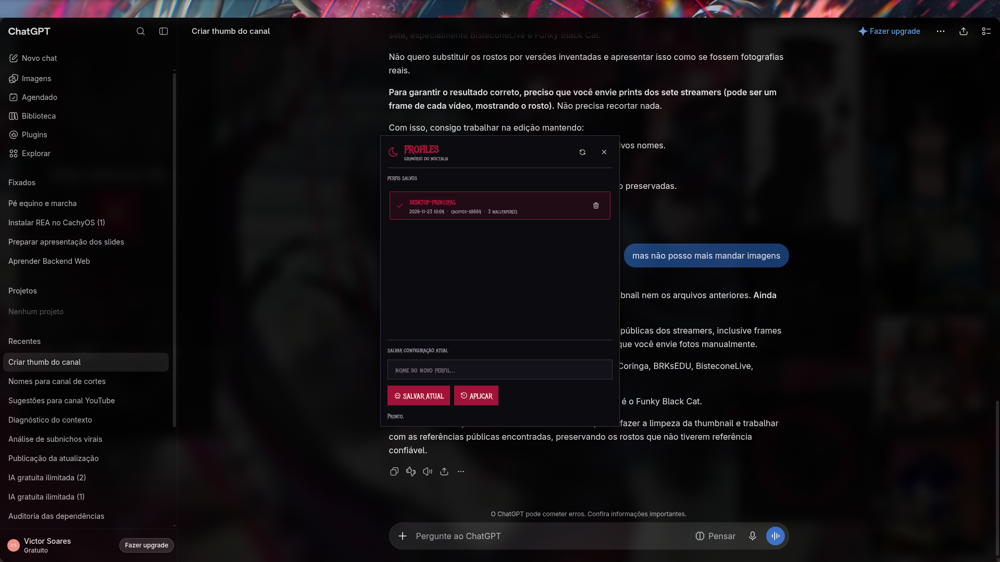

> **📦 Fonte de plugins:** este plugin também está disponível (junto com futuros plugins) em [Akimitsu76/noctalia-plugins](https://github.com/Akimitsu76/noctalia-plugins). Adicione como fonte: `noctalia msg plugins source add akimitsu git https://github.com/Akimitsu76/noctalia-plugins`

# Noctalia Profiles — Grimório do Noctalia

Plugin de **perfis completos** para o [Noctalia](https://noctalia.dev), no estilo do antigo
plugin *profiles* do Noctalia V4. Salva e reaplica **toda** a personalização do desktop:
configuração, widgets, layout, molduras, barra, fontes, cores do sistema, papel de parede
e plugins.



## ✦ O que é salvo

| Item | Origem |
|---|---|
| Configuração da shell / barra / widgets | `~/.config/noctalia/config.toml` |
| Paletas / cor do sistema | `~/.config/noctalia/palettes/` |
| Barra, widgets de desktop, layout, molduras | `settings.toml` `[bar]`, `[desktop_widgets]`, `[widget.*]` |
| Fontes | `settings.toml` `[shell].font_family` |
| Tema / esquema de cores | `settings.toml` `[theme]` + paleta |
| Papel de parede | `settings.toml` `[wallpaper]` + **arquivos copiados** |
| Plugins habilitados + dados | `[plugins]` + `plugins-data/` |
| Metadados | `manifest.json` (data, host, versão, mapa de wallpapers) |

## ✦ Instalação

### 1. Adicionar como fonte de plugins

O repositório é um *plugin source* do Noctalia: contém `catalog.toml` e um subdiretório por plugin.

```bash
git clone https://github.com/Akimitsu76/noctalia-profiles.git
noctalia msg plugins source add victor-profiles git file://$HOME/noctalia-profiles
noctalia msg plugins update victor-profiles
noctalia msg plugins enable victor/profiles
```

### 2. Instalar o motor de perfis (CLI)

O painel e o serviço chamam o executável `noctalia-profile`:

```bash
install -Dm755 bin/noctalia-profile ~/.local/bin/noctalia-profile
```

### 3. (Opcional) Moldura gótico-dark nos widgets

```bash
install -Dm755 bin/noctalia-widget-frames ~/.local/bin/noctalia-widget-frames
noctalia-widget-frames
noctalia msg config-reload
```

O Noctalia v5.5+ **não suporta borda nativa** em widgets de desktop. Este script
gera **stickers PNG transparentes** com borda gótica dupla e os sobrepõe a cada
widget (exceto `victor/fastfetch-desktop:*` e `tausif/ncs-visualizer:*`).

| Elemento | Valor |
|---|---|
| Borda externa | 3px `#a11239` (primary) |
| Borda interna | 2px `#d21f3c` (error) |
| Cantos | retos (radius 0) |
| Interior | transparente (widget original visível) |

As molduras ficam em `~/.local/state/noctalia/frames/`. O script é idempotente:
remove molduras antigas e recria. Requer `python3-pillow`.

## ✦ Uso

### Painel gótico

```bash
noctalia msg panel-toggle victor/profiles:profiles
```

Atalho sugerido (niri):

```kdl
Mod+Shift+P { spawn-sh "noctalia msg panel-toggle victor/profiles:profiles"; }
```

### IPC (service)

```bash
noctalia msg plugin victor/profiles:service all "save  meu-setup"
noctalia msg plugin victor/profiles:service all "apply meu-setup"
noctalia msg plugin victor/profiles:service all "list"
noctalia msg plugin victor/profiles:service all "delete meu-setup"
```

### CLI

```bash
noctalia-profile save  <nome>
noctalia-profile apply <nome>
noctalia-profile list
noctalia-profile delete <nome>
```

## ✦ Persistência

- Tudo fica em `~/.local/state/noctalia/profiles/` — sobrevive a atualizações do pacote.
- `systemd/noctalia-profile-persist.service` reaplica moldura + re-materializa o plugin no login.
- `hooks/noctalia-profile.hook` (pacman) reaplica em tempo real após atualizar o `noctalia`.

Instalar o hook:

```bash
sudo install -Dm755 bin/noctalia-profile-hook.sh /usr/local/bin/noctalia-profile-hook.sh
sudo install -Dm644 hooks/noctalia-profile.hook /etc/pacman.d/hooks/noctalia-profile.hook
```

## ✦ Estrutura do perfil

```
~/.local/state/noctalia/profiles/<nome>/
├── config/            # config.toml + palettes
├── settings.toml      # barra, widgets, tema, wallpaper, plugins
├── plugins-data/      # estado dos plugins
├── wallpapers/        # arquivos de wallpaper copiados
└── manifest.json      # metadados
```

## ✦ API do plugin

- `plugin_api = 46`
- Entradas: `[[panel]]` e `[[service]]`
- Abrir painel: `noctalia msg panel-toggle victor/profiles:profiles`

## Licença

MIT © Akimitsu76
